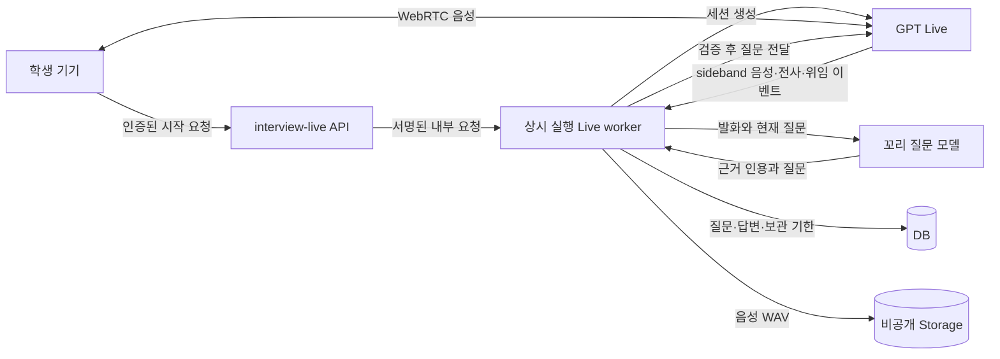

# GPT Live 실전 모의면접 구현 · 2026-10-21

상태: 로컬 구현·격리 검증 완료, 운영 미적용. 실제 OpenAI 음성 호출, 실제 기기 마이크/스피커, 운영 Storage 업로드·재생 및 과금 검증은 아직 하지 않았다. 화면 검토 자료는 명시적으로 표시한 가상 답변이며 음성 정확도 측정 결과가 아니다.

## 앱 연결 구현 — 현재 적용할 구성

2026-10-21 앱 구현 요청에 따라 **별도 상시 worker 없이 Vercel에서 처리하는 경로**를 추가했다. 아래의 기존 worker 운영 설명은 선택 가능한 이전 경로다. 현재 로컬 설정은 `INTERVIEW_LIVE_TRANSPORT=vercel`, `INTERVIEW_LIVE_ENABLED=false`이며 운영 배포·기능 활성화는 하지 않았다.

- 학생 앱의 `모의면접 → 실전 모의면접 (AI)`에서 기존 로그인·기기 인증으로 30초 유효 연결표를 받는다. 연결표는 학생 신원·요청 ID·WebRTC 제안에 묶이며 API 키는 포함하지 않는다. URL에 연결표를 넣지 않는다.
- `/api/interview-live-socket`은 같은 사이트의 연결만 허용하고, 면접 하나의 제어 명령을 같은 연결에서 처리한다. 시작·답변 완료·종료를 허용하며 브라우저의 임의 질문·학생 신원·provider 명령을 받지 않는다. DB의 요청 ID 중복 검사와 학생당/전체 이용 한도는 여러 함수 인스턴스에도 적용된다.
- 학생 음성은 WebRTC로 OpenAI에 전달된다. Vercel은 별도 sideband에서 전사·원음·꼬리 질문을 관리한다. 유료 세션 생성 요청이나 끊긴 제어 연결을 자동 재생성하지 않는다. 끊기면 면접을 종료하고 기록을 복구하는 방식이며 무중단 재접속은 제공하지 않는다.
- 원음은 채널별 20초 크기의 WAV 구간으로 나누고 약 10초 간격으로 비공개 Storage에 저장한다. 임시 로컬 디스크의 지속성을 전제로 하지 않는다. 종료 시 학생/면접관 WAV를 각각 완성하고 임시 구간 파일을 지운다. 저장 실패 시 이미 업로드된 구간은 복구 대상으로 유지한다.
- 진행 중 전사도 원음 체크포인트와 함께 저장한다. 질문 경계 저장과 순서를 직렬화하여 이전 체크포인트가 새로운 답변 경계를 덮어쓰지 못하게 한다. 질문이 바뀌면 현재 질문·자막 영역을 초기화한다.
- 보호된 `/api/interview-live-cleanup`을 1분마다 호출하여 종료 확인, 중단 녹음 복구, 보관 기한 만료 파일 삭제 후 DB 삭제를 수행한다. 복구된 녹음은 `recording_partial=true`로 표시하며 학생/관리자 화면에 마지막 저장 이후 구간이 빠질 수 있음을 안내한다. 원본 원음·전사는 기기/네트워크/함수 장애 직전 일부 유실될 수 있다. 저장소 장애 시 물리 삭제가 지연되므로 실패 로그 감시가 필요하다.
- 기존 직무 시험·인성 연습·관리자 권한·일반 수강생 화면 범위는 유지한다. 확정 점수는 계속 기록하지 않으며 기존 이중 전사/독립 채점 검증 경로와 구분한다.

### Vercel 운영 환경 변수

```text
INTERVIEW_LIVE_TRANSPORT=vercel
INTERVIEW_LIVE_ENABLED=false
INTERVIEW_LIVE_RUNTIME_SECONDS=800
INTERVIEW_LIVE_WORKER_SECRET=<이미 만든 서버 전용 서명 비밀>
CRON_SECRET=<별도로 만든 32자 이상 예약 작업 비밀>
OPENAI_API_KEY=<발급한 제한 권한 키>
INTERVIEW_LIVE_FOLLOWUP_MODEL=gpt-6-astra
SUPABASE_URL=<기존 프로젝트>
SUPABASE_SERVICE_ROLE_KEY=<기존 서버 전용 키>
```

이 경로에서는 `INTERVIEW_LIVE_WORKER_URL`·`INTERVIEW_LIVE_SPOOL`과 별도 Node 서비스가 필요 없다. `vercel.json`에 소켓 함수 최대 800초, 정리 함수 최대 300초, 1분 간격 예약 작업을 설정했다. 소켓은 면접 최대 600초 및 종료·저장 여유 시간을 사용한다. `waitUntil`로 연결 종료 후 정리 작업을 함수 수명 내에서 유지한다. [Vercel WebSocket 문서](https://vercel.com/docs/functions/websockets), [실행 시간](https://vercel.com/docs/functions/configuring-functions/duration), [waitUntil](https://vercel.com/docs/functions/functions-api-reference/vercel-functions-package)

**운영 전 남은 항목:** 사용 중인 Vercel 요금제의 800초 함수·1분 Cron 지원 확인, 환경 변수 등록, 기존 면접 마이그레이션 및 수정한 미적용 Live 마이그레이션 적용, 검토된 질문 공개와 수강 종료일 등록, OpenAI 결제 설정, 실제 기기 음성·저장·재생·단절·만료 삭제 및 비용 검증. 이번에 새 서버를 구매하거나 배포하지 않았다. 로컬 키는 2026-11-20 만료이며 교체가 필요하다.

검증: 실제 로컬 WebSocket 서버와 WebRTC 모의 기기를 연결하여 인증된 시작→첫 질문→heartbeat→종료→DB/녹음 저장 흐름을 통과했다. 연결표 위조·제안 불일치·만료·재사용, 다른 origin 거부, 저장소 실패, 구간 복구, 삭제 순서 및 학생·관리자 권한 테스트를 포함한다. OpenAI 호출과 Storage는 가상 응답이다. `npm run test:interview-live`, 기존 `test:interview`, `test:interview-exam`, 배포 안전성 테스트 및 격리 빌드가 통과했다. 테스트 통과는 실제 발화 정확도나 운영 Vercel 연결 검증을 뜻하지 않는다.

## 공통 기능과 기존 worker 경로 참고

- 학생 앱의 `모의면접 → 실전 모의면접 (AI)` 및 면접반 웹의 동일 메뉴에서 시작한다. 기존 직무 시험·인성 연습 메뉴와 일반 학생 화면은 유지한다.
- GPT Live 음성 모델과 WebRTC를 연결한다. 한국어 면접관 목소리는 `noeul`로 시작하며 대화 중 음성을 바꾸지 않는다. 프런트엔드에는 API 키를 전달하지 않는다. [Live 세션 생성 공식 문서](https://developers.openai.com/api/reference/resources/live/methods/create)
- 면접반 학생, 이용 기간, 공개된 직렬 질문 3개 이상을 서버에서 확인한다. 초기 음성 대상은 한 번에 읽기 적합한 180자 이하 질문이며 긴 질문은 기존 질문 DB에 그대로 유지한다. 질문 본문·분류·개정번호만 세션에 고정한다. 정답·채점표·해설은 음성 모델 및 꼬리 질문 모델에 전달하지 않는다.
- 기본 질문 3개, 기본 질문마다 꼬리 질문 최대 2개, 최대 10분. 학생당 하루 3회, 동시 5명으로 제한한다. 이는 초기 보수적 운영 한도이며 실제 부하 시험을 거친 용량 보장이 아니다.
- 마이크 확인, 면접관 음성 재생, 실시간 자막, 답변 완료, 종료를 제공한다. 마이크 권한 실패와 자동 재생 차단을 안내하며 종료·이동 시 트랙을 정리한다.
- 학생 본인과 `interview.read` 권한이 있는 관리자만 기록을 조회한다. 학생 최초 답변과 꼬리 질문 답변은 별도 항목이다. 기록 목록은 30개씩 페이지를 나눈다.

## 연결과 질문 통제



`api/interview-live.js`는 기존 로그인·기기 인증을 재사용한다. 검증한 학생/관리자 신원으로 worker 요청 본문을 다시 만들고 HMAC 서명한다. 브라우저가 보낸 actor, 면접관 지시문, provider 세션 ID는 받지 않는다. WebRTC 프런트엔드가 보낼 수 있는 Live 제어 이벤트는 `session.close`로 제한한다. 질문 추가는 서버의 sideband 연결에서 수행한다. [서버 제어 공식 문서](https://developers.openai.com/api/docs/guides/voice-server-controls)

Live가 답변 종료를 감지해 위임하거나 학생이 ‘답변 완료’를 누른 뒤 처리한다. 자동 진행은 전사 및 음성 입력의 조용한 구간을 기다리고, 꼬리 질문 모델이 미완료 문장·단순 반복 요청인지 확인한다. 전사 조각 도착만으로 답변을 완료하지 않는다. 위임 이벤트 ID와 발화 버전으로 중복 호출을 막으며, 생성·DB 저장 중 발화가 이어지면 다음 질문을 폐기한다.

꼬리 질문에는 최신 답변의 연속된 실제 인용이 필요하다. 없는 인용, 너무 긴 질문, 이미 한 질문은 거부한다. 첫 답변 경계를 DB에 저장한 다음에만 추가 질문을 전달한다. 모델 장애 시 임의의 대체 질문을 만들거나 정답을 알려주지 않고 답변을 유지한다. 서버 모델 호출은 세션당 최대 12회로 제한하며 유료 생성 요청을 자동 재시도하지 않는다.

음성 모델은 질문을 자연스럽게 표현할 수 있으므로 문자 그대로 읽는다는 보장은 없다. 의도한 질문과 실제 면접관 전사(`spokenQuestion`), 양쪽 음성을 남겨 검토한다. 대화의 자연스러움·끊어 말하기·침묵 인식은 실제 한국어 발화로 추가 검증해야 한다.

## 기록과 정확도

현재 추가한 것은 **음성 실전 연습**이다. 카메라 영상 녹화·업로드는 이번 변경에 포함하지 않는다. 직무 O·△·X 자동 확정 채점과 인성 평가 결과 제공도 이 음성 진행 경로에 연결하지 않았다.

- 음성: 학생 입력과 면접관 출력을 별도의 PCM WAV 파일로 보관한다. 서버에서 받은 입력과 출력 채널을 분리하여, 면접관이 말한 단어가 학생 답변에 섞여 인정되지 않게 한다. 원음에는 배경음·누화가 있을 수 있다.
- DB: 질문 순서, 최초/꼬리 질문 구분, 상위 질문 ID, 전사, 입력 음성 바이트 구간, 완료 여부, 기한만 저장한다. 모든 `grade`, `score`는 `null`이며 전사는 `live_sideband_unverified`로 표시한다.
- 출력 음성은 제공된 시간 위치에 기록한다. 입력 음성은 수신 순서로 이어 기록한다. 두 플레이어의 타임라인이 정확히 동기화되었다고 가정하지 않는다. 반사된 입력은 모델이 실제로 소비한 음성과 반드시 동일하다고 단정하지 않는다. [Live 대화 관리 공식 문서](https://developers.openai.com/api/docs/guides/live-conversations)
- 기존 `interview-exam` 이중 전사·독립 판정 검증 경로는 별도로 유지한다. Live 원음은 24kHz이고 기존 검증 입력은 16kHz/최대 90초이므로, 최종 시험 연결에는 답변 구간 추출·변환·사람 검토 및 실제 음성 평가가 추가로 필요하다. 라이브 자막으로 확정 점수를 쓰지 않는다.

10분의 24kHz/16bit/mono 원음은 한 채널 약 28.8MB, 두 채널 최대 약 57.6MB다. 음성 바이너리를 관계형 DB에 넣지 않는다. 향후 공유용 압축 파일을 추가할 때에도 검증용 원음 정책을 먼저 정해야 한다. 현재 DB 요금제·실제 잔여 용량을 조사한 결과는 아니다.

## 보관 및 장애 처리

수강 종료일의 한국 시간 날짜를 기준으로, 종료 후 30일째 날까지 보관한다. 예: 10월 21일 수강 종료 → 11월 20일 23:59:59까지 → 11월 21일 00:00부터 조회 거부. 종료일이 없으면 새 음성 면접을 시작하지 않는다. 종료일 변경 시 기존 기록의 기한을 갱신하며, 종료일을 다시 비워도 기존 기한을 무기한으로 늘리지 않는다.

Storage 버킷 `interview-live`는 비공개다. 인증 후 최대 60초짜리 재생 링크를 발급하며 남은 보관 기간보다 길게 발급하지 않는다. 기한 이후에는 DB 조회를 차단하고, 상시 worker의 유지관리 작업이 Storage 파일 → 서버 임시 파일 → DB 순서로 삭제한다. 정상 실행 시 15초 간격으로 처리한다. worker/Storage 장애 중 물리 삭제가 지연될 수 있으므로 유지관리 오류 알림과 재시작 감시가 운영 필수다. 공개 파일 URL은 사용하지 않는다.

연결 중 heartbeat가 45초 동안 없거나 최대 시간이 지나면 서버가 세션 종료를 요청한다. `session.closed` 확인이 없으면 sideband를 다시 연결해 종료한다. provider가 세션 부재를 응답하면 종료된 것으로 처리한다. 생성 응답이 유실되어 provider ID 자체를 모르면 `unknown`으로 잠그고 운영자가 제공자 사용 내역에서 확인하기 전 새 연결을 허용하지 않는다. 중복 비용을 막기 위해 이 상태를 자동으로 해제하지 않는다.

원음은 접근 제한된 로컬 spool에 먼저 기록한다. 종료 후 비공개 Storage 업로드가 실패하면 파일을 유지하고 유지관리 작업에서 재시도한다. 프로세스가 비정상 종료된 기록은 interrupted로 처리하고 남은 WAV 헤더를 복구해 업로드한다. 강제 종료 직전의 아직 DB에 저장되지 않은 전사와 디스크에 기록되지 않은 음성은 유실될 수 있다. 세션이 진행 중일 때 원음 파일을 외부에 공개하지 않는다.

## 운영 연결에 필요한 설정

선택적인 기존 worker 경로는 `tools/interview-live-worker`를 **상시 Node 서비스 1개**로 실행한다. 이 경로에서만 단일 worker와 영속 디스크가 필요하다. 여러 worker 인스턴스의 로드밸런싱은 지원하지 않는다. 앱의 현재 기본 연결 대상인 Vercel 경로는 문서 상단을 따른다.

2026-10-21 재확인: [Vercel 공식 WebSocket 문서](https://vercel.com/docs/functions/websockets)는 Functions의 WebSocket 연결을 지원하며 연결마다 한 인스턴스에 고정된다고 설명한다. [실행 시간 문서](https://vercel.com/docs/functions/configuring-functions/duration)에 따르면 Fluid compute의 Hobby 최대 실행 시간은 300초, Pro/Enterprise는 일반 최대 800초다. 현재 계정 요금제·설정은 확인되지 않았다. 다음 전환 항목은 문서 상단의 Vercel 경로로 구현했으며 운영 검증은 남아 있다.

- 학생과 Vercel 사이에 인증된 제어 연결을 유지하고, 같은 호출에서 OpenAI sideband를 관리한다. 현재 짧은 HTTP 요청마다 메모리 세션을 조회하는 구조를 그대로 배포하면 안 된다.
- 원음은 로컬 영속 디스크 대신 Storage에 구간별로 저장하고, 복구 가능한 순서·완료 상태를 DB에 기록한다. 메모리·임시 파일이 다음 호출에도 남아 있다고 가정하지 않는다.
- 같은 제어 연결 안에서 세션을 관리하고 중복 세션 생성을 차단한다. 연결 단절은 종료·복구로 처리하며 자동 재접속으로 유료 세션을 다시 만들지 않는다. 종료 후 업로드를 위한 실행 시간 여유도 둔다.
- 상시 worker의 만료 정리를 별도 예약 작업으로 이전하고, 실제 운영 요금제에서 녹음 유실·종료·보관 만료 삭제를 검증한다.

이 방안은 별도 서버 관리 부담을 줄이는 후보이며, Vercel 실행·저장소·OpenAI 사용료가 없어진다는 뜻은 아니다. 음성 인식과 채점 정확도는 서버가 항상 켜져 있는지와 별개로 실제 원음·전사·판정 검증을 통해 확인해야 한다.

웹 API 서버:

```text
INTERVIEW_LIVE_ENABLED=false
INTERVIEW_LIVE_WORKER_URL=https://<private-or-authenticated-worker-host>
INTERVIEW_LIVE_WORKER_SECRET=<32자 이상의 무작위 서버 전용 비밀>
```

worker:

```text
OPENAI_API_KEY=<Live 사용 권한이 있는 서버 전용 키>
INTERVIEW_LIVE_FOLLOWUP_MODEL=<Structured Outputs를 지원하는 검증한 모델 ID>
INTERVIEW_LIVE_WORKER_SECRET=<웹 API와 동일한 비밀>
SUPABASE_URL=<기존 프로젝트 URL>
SUPABASE_SERVICE_ROLE_KEY=<서버 전용 키>
INTERVIEW_LIVE_SPOOL=<웹으로 노출하지 않는 영속 디스크 절대 경로>
INTERVIEW_LIVE_BIND=127.0.0.1
PORT=3091
```

worker 의존성은 별도 package-lock으로 고정했다. `npm ci --prefix tools/interview-live-worker --ignore-scripts` 후 환경 변수를 안전한 배포 설정에 넣고 `node tools/interview-live-worker/server.cjs`로 실행한다. 공개 인터넷 구간은 TLS를 사용한다. 기본 바인딩은 loopback이며 프록시/플랫폼 연결 방식에 맞춰 명시적으로 설정한다. 서버 간 시계는 서명 허용 범위(30초) 안에 맞아야 한다. 프로세스 재시작 정책, 영속 볼륨, 디스크 용량과 유지관리 실패 알림을 구성한다. 키를 `config.js`, 프런트엔드 변수나 저장소에 적지 않는다.

운영 DB에는 앞선 면접반 마이그레이션과 `20261021060740_interview_live_sessions.sql`을 순서대로 적용해야 한다. 현재 적용하지 않았다. 비공개 Storage 버킷과 서버 역할 권한을 확인한 뒤 검토된 질문을 공개하고 학생 종료일을 등록한다. 실제 기기에서 1회 연결·정상 종료·연결 단절·음성 재생·만료 삭제를 확인한 후 기능 플래그를 활성화한다. 푸시 및 배포는 AGENTS.md에 따라 사용자 최종 확인 후 진행한다.

## 로컬 검증

### 2026-10-21 연결 준비 확인

**키 발급 후 갱신:** 사용자 요청으로 OpenAI `Personal Organization / Default project`에 `ronpark-interview-live-20261021` 키를 발급하고 로컬 `.env.local`의 `OPENAI_API_KEY`에 등록했다. 기존 설정은 보존했다. 키는 Restricted이며 모델 조회 Read, Responses Write, Live Write만 선택했다. 대시보드 표시 만료일은 **2026-11-20**이다. 무기한 설정은 자동 승인 검토에서 거부되어 30일로 제한했다. 계속 운영하려면 만료 전 안전한 키 교체가 필요하다. 키 값은 문서·로그·대화에 남기지 않았다.

등록 후 읽기 전용 점검에서 `gpt-live-1` 및 `gpt-6-astra` 모델 조회가 모두 성공했다. 이는 키 인증·모델 조회 권한 확인이며 음성 연결 성공을 뜻하지 않는다. 결제 화면은 Free trial / 잔액 **$0.00** / Add payment details 상태다. 결제 정보 입력·크레딧 구매·유료 음성/텍스트 생성은 하지 않았다. 운영 면접 테이블·버킷은 여전히 미적용이고 Vercel 환경 변수에도 아직 이 키를 등록하지 않았다. 기능 플래그는 계속 꺼져 있다. 아래 항목은 키 발급 전 초기 점검 기록이다.

- 기존 Supabase 프로젝트 `ehzrwkvuarertwvwoyus`를 읽기 전용으로 확인했다. 운영 DB의 `ip_*` 테이블과 `interview-live` 버킷은 아직 없다. 로컬 서비스 키를 사용하는 REST 점검에서도 테이블 404 / 버킷 400으로 준비되지 않은 상태를 확인했다. 마이그레이션은 적용하지 않았다.
- 로컬 `.env.local`의 기존 값을 보존하고 누락된 Live 설정만 추가했다. 서버 간 비밀은 무작위 32바이트로 생성했고, 기능은 `false`다. OpenAI 키 입력란은 비워 두었다. 로컬 임시 원음 위치는 `.tmp/interview-live-spool`이며 Git·Vercel 배포에서 제외되고 로컬 정적 서버가 접근을 차단한다. 운영 서버에서는 별도 영속 볼륨과 OS 접근 권한을 구성해야 한다.
- 꼬리 질문 모델의 초기 설정은 `gpt-6-astra`다. [OpenAI 공식 Structured Outputs 안내](https://developers.openai.com/api/docs/guides/structured-outputs)의 신규 프로젝트 권장을 참고한 후보이며, 이 프로젝트에서 실제 한국어 질문 품질·지연·비용을 검증한 결과는 아니다. 키 등록 후 모델 접근 권한 확인과 실제 발화 검증이 필요하다.
- 기존 Vercel CLI 인증으로 프로젝트 환경 변수 조회를 시도했으나 HTTP 403으로 거부됐다. 원격 환경 변수 존재 여부는 확인하지 못했다. 상시 worker 호스팅 위치도 아직 정해지지 않았다.
- `npm run check:interview-live`는 로컬 설정을, `npm run check:interview-live -- --remote`는 추가로 모델 조회·빈 DB 조회·비공개 버킷 설정을 확인한다. GET 요청만 사용하며 음성 세션·답변 생성·DB 변경·파일 업로드를 하지 않는다. 키 값과 서버 오류 본문은 출력하지 않는다. 모델 조회 성공만으로 Live 사용 권한·결제 상태·RPC 권한·업로드·음성 품질이 검증되지는 않는다.
- 키·DB·Storage·worker 호스트 준비를 마친 뒤, 프로젝트 루트에서 `npm run start:interview-live-worker`로 실행한다. 이 명령은 `.env`와 `.env.local`을 읽으므로 공유 PC의 세션·파일 접근 권한을 확인한다. worker 시작 시 보관 만료 정리 작업도 실행되므로 준비 확인 전에 운영 설정으로 실행하지 않는다. 공개 호스트를 사용할 때에는 웹 API의 worker URL과 양쪽 비밀을 일치시킨다.
- 이번 연결 준비 검증: `npm run test:interview-live` 통과. 실제 API 키가 없어서 OpenAI 호출은 수행하지 않았다. 푸시·배포·기능 활성화도 수행하지 않았다.

- `npm run test:interview-live`: 인증/위조 요청, RLS, 소유권, 동시 입장 제한, idempotency, 답변 경계, 꼬리 질문 수, 발화 재개 시 폐기, WAV 헤더/무음 위치, 만료 삭제, WebRTC 시작 순서·마이크 해제. 제공자와 네트워크는 모의 응답이다.
- `npm run test:interview`, `npm run test:interview-exam`: 기존 면접 준비·신청·작성·첨삭·채점 검증 회귀 검사.
- `node scripts/verify-interview-build.cjs`: 격리 빌드 및 문법 검사, 기존 config.js 보존.
- `node scripts/interview-prep-ui-qa.cjs --serve --live-fixture`: 임베디드 DB의 가상 기록으로 학생/관리자 화면 확인. 실제 음성 시작은 차단한다. 학생 모바일 390×844 및 관리자 메뉴를 브라우저에서 검토했다.

학생 원음으로 인식률·부정/정정 발화·숫자/단위·전문용어·억양·소음 환경을 측정한 결과는 아직 없다. 최종 성적에 연결하기 전에 별도 정확도 검증이 필요하다.

## 2026-10-24 통합 출시 준비

현재 운영 환경에는 Live 연결에 필요한 환경 변수와 CRON_SECRET이 없다. 초기 통합 출시의 vercel.json에는 자동 정리 예약을 등록하지 않는다. 비활성 기능 때문에 매분 인증 실패 요청과 불필요한 실행이 발생하지 않도록 하기 위한 조치다.

Live 활성화 전에는 운영 환경 변수·비공개 버킷·실제 음성 연결을 검증하고, vercel.json의 crons에 경로 /api/interview-live-cleanup, 일정 * * * * *를 함께 등록하여 배포해야 한다. 기존 녹음이 있는 활성 운영 환경에서는 보관 만료 정리를 중단해서는 안 된다. 별도 worker 경로를 선택한다면 해당 worker의 정리 작업을 유지한다.
